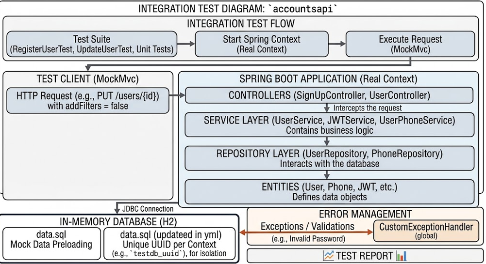
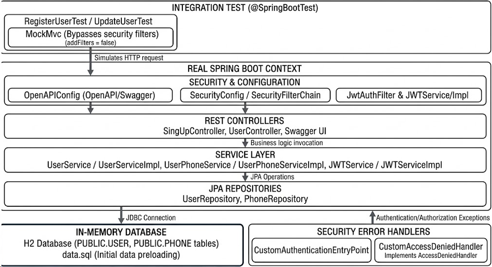

# Accounts API Service

Simple RESTful API built with Spring Boot 3.3.4 for managing user accounts and phone numbers, featuring JWT authentication, Spring Data JPA, and H2 database.

---

## Architecture Overview

The project follows a standard Layered Architecture:

Client (HTTP / JSON)
└── Controller Layer (REST Controllers, API Exception Handler)
└── Service Layer (Business Logic)
└── Repository Layer (Spring Data JPA)
└── Database (H2 In-Memory)

Key Highlights:
- Base Context Path: /account/api
- Database: H2 In-Memory (jdbc:h2:mem:testdb)
- Security: Stateless JWT authentication via Spring Security
- Error Format: All error responses return {"mensaje": "description"}
- Interactive Docs: http://localhost:8080/account/api/swagger-ui.html
- JSON Documentation: http://localhost:8080/account/api/v3/api-docs

---

## Tech Stack

- Java 17 / Spring Boot 3.3.4
- Spring Data JPA & H2 Database
- Spring Security & JWT (io.jsonwebtoken:jjwt-api:0.11.5)
- Jakarta Validation & SpringDoc OpenAPI 2.6.0
- Lombok

---

## How to Run

1. Build project:
   mvn clean package

2. Run application:
   mvn spring-boot:run

---

### 1. Register User (Public)
Creates a user and returns a JWT token.

POST /sign-up
Headers: Content-Type: application/json
Body:
{
"name": "Josue Reyes",
"email": "josue@example.com",
"password": "Password123!",
"phones": [
{
"number": "5551234",
"cityCode": "1",
"countryCode": "505"
}
]
}
Response: 201 Created (contains generated JWT token)

---

### Authenticated Requests Note
All endpoints below require the following header:
Authorization: Bearer <TOKEN_FROM_SIGN_UP>

---

### 2. Get User by ID
GET /users/{id}
Headers: Authorization: Bearer <TOKEN>
Response: 200 OK

---

### 3. Update User
PUT /users/{id}
Headers:
Authorization: Bearer <TOKEN>
Content-Type: application/json
Body:
{
"name": "Josue David",
"email": "josue.david@example.com",
"phones": [
{
"id": "1",
"number": "5559876",
"cityCode": "1",
"countryCode": "505"
}
]
}
Response: 200 OK

---

### 4. Delete User
DELETE /users/{id}
Headers: Authorization: Bearer <TOKEN>
Response: 204 No Content

---

### 5. Get User Phones
GET /users/{userId}/phones
Headers: Authorization: Bearer <TOKEN>
Response: 200 OK

---

### 6. Add Phone to User
POST /users/{userId}/phones
Headers:
Authorization: Bearer <TOKEN>
Content-Type: application/json
Body:
{
"number": "88887777",
"cityCode": "2",
"countryCode": "505"
}
Response: 201 Created

---

### 7. Get Phone by ID
GET /users/{userId}/phones/{id}
Headers: Authorization: Bearer <TOKEN>
Response: 200 OK

---

### 8. Update Phone
PUT /users/{userId}/phones/{id}
Headers:
Authorization: Bearer <TOKEN>
Content-Type: application/json
Body:
{
"number": "99998888",
"cityCode": "2",
"countryCode": "505"
}
Response: 200 OK

---

### 9. Delete Phone
DELETE /users/{userId}/phones/{id}
Headers: Authorization: Bearer <TOKEN>
Response: 204 No Content

## Endpoint Testing Guide

Base URL: http://localhost:8080/account/api

## Unit Test and Integration Test
### 1. Test architecture

### 2. Run Test
`./mvnw clean test`

## Diagram
